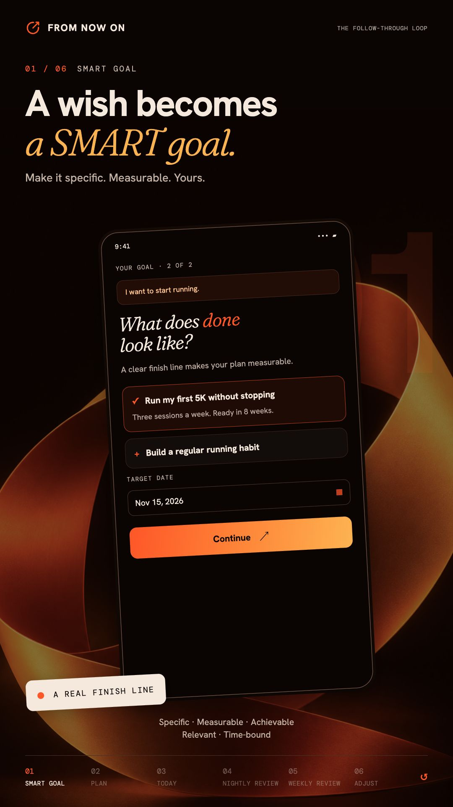
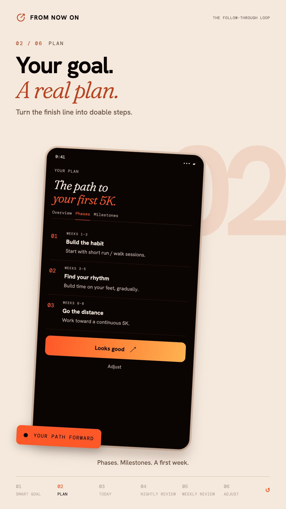
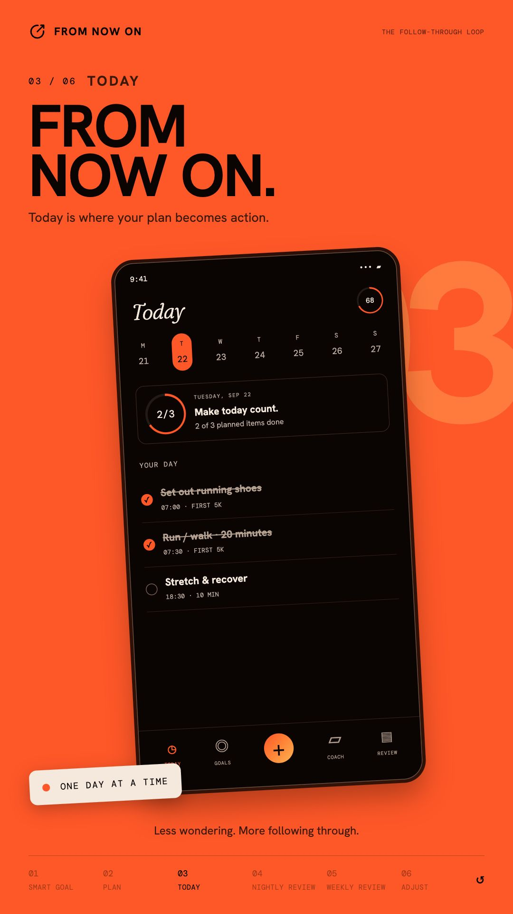
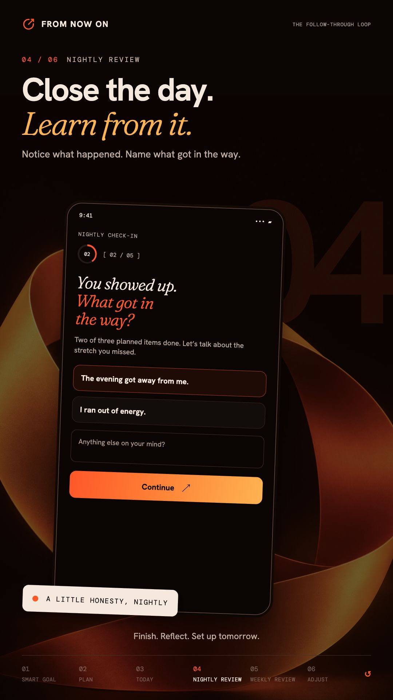
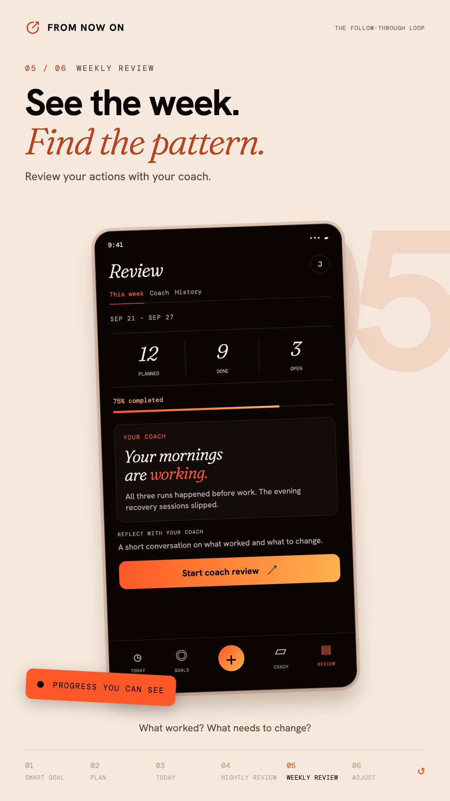
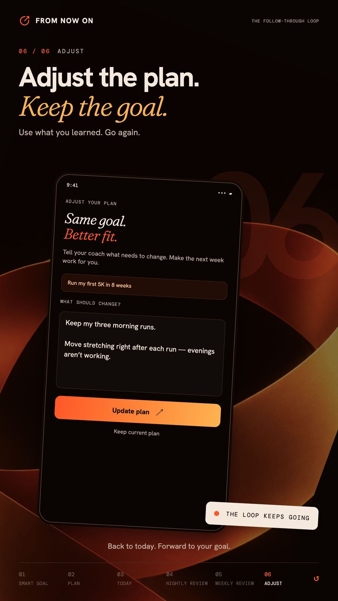
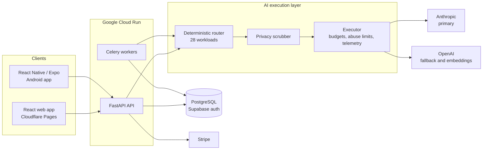

# From Now On

**An AI execution system that turns long-term goals into plans, daily agendas, and coached reviews.**

Live on the web at [fromnowon.io](https://fromnowon.io) and on [Google Play](https://play.google.com/store/apps/details?id=com.fromnowon.app).

> The source code is private. This repository describes the product and its architecture.
> I am glad to give a live code walk-through on request.

I designed, built, and operate From Now On by myself, from the first commit in November 2025 to production.

---

## What it does

1. **SMART goal** - The coach turns a vague wish into a specific, measurable goal.
2. **Plan** - The goal becomes phases, milestones, and weekly activities.
3. **Today** - The plan becomes a daily agenda. Incomplete items roll forward.
4. **Nightly review** - A short check-in records what happened and what got in the way.
5. **Weekly review** - The coach finds patterns across the week.
6. **Adjust** - The plan changes based on what the user learned.

| | | |
|---|---|---|
|  |  |  |
|  |  |  |

---

## Architecture

| Layer | Technology |
|---|---|
| Web | React, Cloudflare Pages |
| Mobile | React Native (Expo), Google Play |
| API | Python, FastAPI, SQLAlchemy, Alembic |
| Background jobs | Celery, Redis |
| Data and auth | PostgreSQL, Supabase auth (email, Google) |
| AI | Anthropic (tool use, SSE streaming), OpenAI (fallback, embeddings), LiteLLM |
| Hosting and operations | Google Cloud Run, Docker, Cloud Monitoring, Sentry |
| Billing | Stripe |

---

## Engineering decisions

### One AI execution layer

Only one backend package can import an LLM SDK. All feature code calls a single executor.
A guard test fails the build if any other module imports a provider SDK directly.
This keeps model choice, cost control, privacy, and telemetry in one place.

### Deterministic model routing

Each kind of model call is a named **workload**, such as `plan_generation`, `daily_nudge`, or
`safety_classification`. There are 28 workloads. A routing table maps each workload to a
model tier, a thinking mode, and a fallback policy.

The router never reads prompt content, sentiment, or message length. The call site
always knows its workload, so the same request always takes the same route. To add a
new kind of call, you add one workload and one routing rule. Feature code does not change.

### Provider fallback

Anthropic is the primary provider. If a call fails, the fallback policy can send it to
OpenAI through LiteLLM. Tests cover structured output and tool use for both providers.

### Evaluation before change

Before I redesigned the planner, I built an evaluation harness for it:

- A **35-item goal corpus**, which includes a **20-item regression set**, narrative and terse
  inputs, safety items, and a benchmark goal.
- Each item records what a good plan **must** do and **must not** do. The corpus is a
  specification, not a snapshot of current output.
- **Layer 1** scoring is structural. It runs a 23-rule plan linter as assertions,
  with no model calls, network calls, or database writes.
- A recorded **baseline** report. Each later planner change is measured against it.

The first baseline showed that **0 of 17** stored plans passed the structural rules, with a
mean of 6.94 errors for each plan. That result is the reason for the planner redesign.
Later layers (a blinded judge, interview quality, latency) are defined in the harness, so
the gaps stay visible.

### Privacy and abuse controls

- A deterministic scrubber removes direct identifiers and replaces personal names with
  relationship labels before a prompt leaves the service.
- Prompts and responses are never logged. Usage events record metadata only.
- Guests can use the coach, so the AI layer limits guests by session **and** by IP address.
  Signed-in users get a burst limit and a monthly token budget.

### Security in the delivery pipeline

A local pre-merge gate runs these scans in parallel:

- Secret scanning (Gitleaks)
- Dependency and container scanning (Trivy)
- Static analysis (Semgrep)
- License checks
- Infrastructure-as-code checks

The backend has about 2,700 automated tests.

---

## About me

I lead security software engineering at Comcast, and I still write production code.
[LinkedIn](https://www.linkedin.com/in/coryradams)
